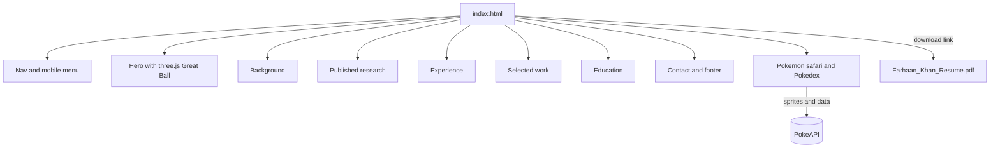
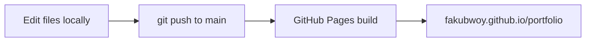

# Farhaan Khan: Portfolio

Live site: https://fakubwoy.github.io/portfolio/

Personal portfolio of Farhaan Khan. It is a single static page with no build step.

## What is on the site

| Section | Anchor | Content |
| --- | --- | --- |
| Hero | `#hero` | Name, intro, resume download, 3D Great Ball rendered with three.js |
| Background | `#background` | About text and photo (`ME.jpg`) |
| Published research | `#research` | IEEE Access paper with DOI link |
| Experience | `#experience` | Work history |
| Selected work | `#work` | Project cards: Droptor, Reznt, Visor, C Compiler Visualizer, Go File Share, PricePulse |
| Education | `#education` | Degree and CGPA |
| Contact | `#contact` | Email link and GitHub, LinkedIn, X profiles |

Extras:

- Light and dark theme toggle, saved in `localStorage` (`fk-theme`).
- Pokemon safari: Gen 5 Pokemon wander across the page and can be caught. Caught ones are saved in `localStorage` (`fk-dex`) and listed in the Pokedex panel. Sprites and data come from PokeAPI.
- Respects `prefers-reduced-motion` (animations calm down instead of turning off).



## Tech

- Plain HTML, CSS and JavaScript, all inline in `index.html`
- [GSAP 3.12.5](https://gsap.com/) with ScrollTrigger for scroll animations (cdnjs)
- [three.js 0.169.0](https://threejs.org/) for the hero 3D scene (cdnjs, loaded with dynamic `import()`)
- [Phosphor Icons 2.1.1](https://phosphoricons.com/) (unpkg)
- Geist and Geist Mono fonts (Google Fonts)
- [PokeAPI](https://pokeapi.co/) for the safari sprites and Pokemon data

## Files

```
index.html               the whole site: markup, styles, scripts
Farhaan_Khan_Resume.pdf  resume linked from the nav, mobile menu and hero
ME.jpg                   photo in the Background section
favicon.ico              site icon
```

## Run locally

Opening `index.html` directly works for most of the page, but the three.js module import and PokeAPI fetches behave better over HTTP. Serve the folder with any static server:

```sh
python3 -m http.server 8000
# then open http://localhost:8000/
```

An internet connection is needed, since libraries, fonts and sprites load from CDNs.

## Update content

All content lives in `index.html`. Find the section by its `id`:

- Intro text: `<section id="hero">`
- About text or photo: `<section id="background">` (replace `ME.jpg` to change the photo)
- Paper: `<section id="research">`
- Jobs: `<section id="experience">`
- Projects: `<section id="work">`, one `<a class="card">` per project
- Degree: `<section id="education">`
- Email and social links: `<section id="contact">` and the footer

To update the resume, replace `Farhaan_Khan_Resume.pdf` with a new file of the same name. The links point to that filename, so nothing else needs to change.

## Deployment

The site is served by GitHub Pages from the root of the `main` branch. Every push to `main` is published automatically.


